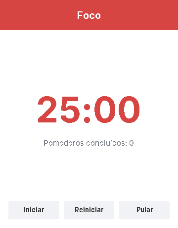

# 🍅 Pomodoro - Timer de Estudos

Cronômetro de foco pela técnica **Pomodoro**, feito em **Java** com Swing. Estude com foco por 25 minutos, descanse 5, e a cada 4 blocos faça um descanso mais longo — tudo controlado automaticamente.




## O que é a técnica Pomodoro?

É um método de estudo simples: você trabalha concentrada por um tempo curto (um "pomodoro" de 25 min) e faz pausas regulares. Isso ajuda a manter o foco e evitar o cansaço. A cada 4 pomodoros, você ganha um descanso maior.

## Funcionalidades

- ⏱️ Ciclo automático: **Foco (25 min) → Descanso curto (5 min)**, e a cada 4 focos um **Descanso longo (15 min)**
- ▶️ Botões de **Iniciar / Pausar / Continuar**
- 🔄 **Reiniciar** o tempo da fase atual
- ⏭️ **Pular** direto para a próxima fase
- 🎨 As cores mudam conforme a fase (vermelho = foco, verde = descanso curto, azul = descanso longo)
- 🔢 Contador de **pomodoros concluídos**
- 🔔 Um "bip" avisa quando troca de fase

## Como executar

Requer o **Java (JDK 17 ou superior)** instalado.

```bash
git clone https://github.com/SEU-USUARIO/pomodoro-timer.git
cd pomodoro-timer
javac *.java
java PomodoroTimer
```

## Como mudar os tempos

Quer um foco de 50 minutos ou um descanso de 10? É só abrir o arquivo **`TipoSessao.java`** e mudar os números:

```java
FOCO("Foco", 25),            // ← troque o 25 pelo tempo de foco que quiser
DESCANSO_CURTO("Descanso curto", 5),
DESCANSO_LONGO("Descanso longo", 15);
```

Depois é só compilar de novo (`javac *.java`).

## Estrutura do projeto

| Arquivo | O que faz |
|---|---|
| `TipoSessao.java` | Enum com os três tipos de sessão e suas durações |
| `PomodoroTimer.java` | A janela (interface) e todo o controle do tempo |

## Tecnologias

Java 21 · Swing (interface gráfica) · `javax.swing.Timer` (contagem de tempo) · sem bibliotecas externas.

---

Feito com 🍅 e ☕ para estudar com foco.
